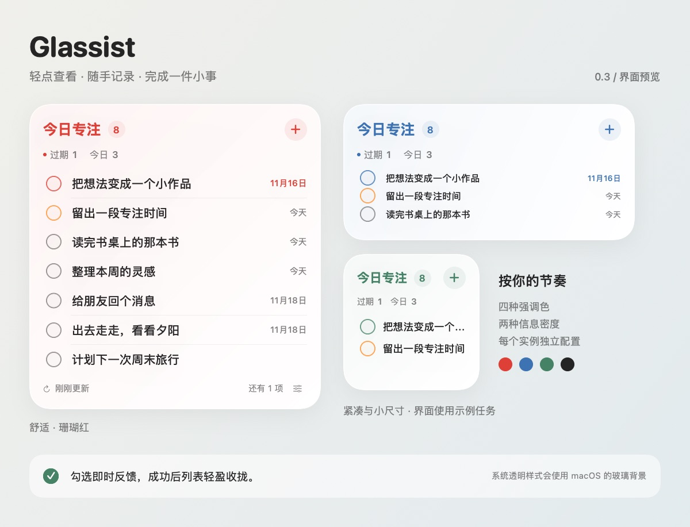

# Glassist

Your Todoist filters, at home on your Mac. 原生 Todoist 过滤器小组件。

Glassist lives alongside Calendar and Weather in Notification Center and on the desktop. Add small, medium or large widgets, each with its own saved Todoist filter.

## A little less switching

- **Open** — click the title or background to open the filter in Todoist; click a task to see its details.
- **Capture** — the top-right **＋** opens Todoist for Mac’s Quick Add. Nothing is submitted automatically.
- **Complete** — ordinary tasks have an optimistic checkmark, followed by a gentle list transition when the server confirms completion. Failed or uncertain results remain visible for checking in Todoist. Recurring tasks open in Todoist.
- **Make it yours** — independent filter, custom title, Roomy/Compact density, Coral/Ocean/Sage/Graphite accents, date and count visibility, and a footer on large widgets.
- **中文 / English** — choose a language in Glassist settings, or follow the system. Each widget can follow the app or override its language. Task and filter names remain as you wrote them.
- **Native materials** — a frosted settings window and system-managed widget glass/tint. macOS owns widget shape, placement and clear appearance.

Right-click a widget → **Edit Glassist** to customize it. The system configuration editor follows your Mac’s language; widget content follows your chosen language.

## Install on your Mac

Requires Apple Silicon, macOS 14+ and full Xcode. Open **Glassist.xcodeproj** for the host app and embedded WidgetKit extension.

1. Sign in to your Apple account in Xcode.
2. Copy `Configuration/LocalSigning.xcconfig.example` to `Configuration/LocalSigning.xcconfig` and enter your Team ID.
3. Run `bash scripts/install-local.sh`. It builds, verifies and installs `/Applications/Glassist.app`.
4. Connect Todoist in the app’s local secure field, then click the menu bar date → Edit Widgets → Glassist.

See [installation and signing](docs/INSTALL.md) for details, including renewal of time-limited Personal Team development profiles. The CI archive is unsigned and is not a ready-to-install release.

## Develop

- `swift test` — API, date, storage, routing, completion-feedback and localization tests.
- `bash scripts/install-local.sh --build-only` — signed local build without replacing the installed app.
- `bash scripts/build-app.sh` — unsigned CI build of the app and extension.
- `bash scripts/render-previews.sh /tmp/Glassist-preview.png` — render the actual widget layout with fictional fixtures; append `--english` for the English version.

Version 0.3 passes **24 tests** and a signed local build on Apple Silicon. The 0.2 installation’s account and filter selections are retained. See [architecture and verification](docs/ARCHITECTURE.md) for behavior and validation boundaries.

| Location | Purpose |
| --- | --- |
| `Sources/Glassist` | Native settings, language selection and Todoist URL forwarding |
| `Sources/GlassistWidgets` | Configurable widgets, layout and completion interactions |
| `Sources/GlassistCore` | Todoist API, shared cache, Keychain, routing and language resources |
| `Configuration` | Shared signing, Info.plist and entitlements |
| `Tests/GlassistCoreTests` | Data, interaction and localization regression tests |

Task refresh is scheduled by macOS; the requested 15-minute interval is not a guarantee. Credentials stay in the shared Keychain, separate from the task cache.
